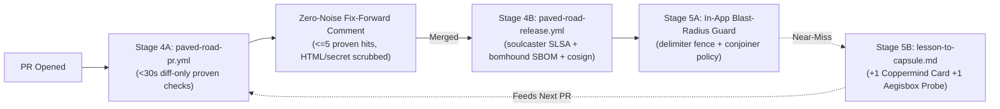

# Portable Paved-Road CI & Production Readiness Guide

> **Reference Blueprint:** `RFC-2026-11-22-48` (*Portable Paved-Road Pipeline & Production Readiness Kit*)  
> **Scope:** Single-Repository Open-Source GitHub Action Workflows, In-App Developer Libraries & Closed Learning Flywheel

> [!NOTE]
> **Safe Harbor & Local-First Scope:** Everything in this kit is 100% single-repository open-source tooling (static GitHub Action templates invoking local single-binary CLIs plus in-process Go/TS/Python developer library recipes). There is **zero** centralized SaaS control plane, **zero** inline enterprise AI proxy/firewall, and **zero** fleet telemetry.

---

## 1. End-to-End Flow (Stages 4, 5 & Closed Loop to Stage 0)



---

## 2. Stage 4A — `<30s` Diff-Only Proven PR Gate (`paved-road-pr.yml`)

Traditional security pipelines dump hundreds of unverified legacy warnings on every PR. The Paved-Road PR Gate runs **only on the PR diff** and **only surfaces proven findings**:

1. **`argus vet --diff --json`**: Intercepts newly added slopsquatted or typosquatted packages.
2. **`soulcaster verify-patch -base origin/main --json`**: Differential AST security check strictly on modified lines.
3. **`aegisbox test --ai-safety --allow-degraded-local --json`** *(optional)*: Runs deterministic abuse-case probes against a strictly loopback (`127.0.0.1`) local endpoint.
4. **Zero-Noise Fix-Forward Formatter ([`scripts/format_fixforward_pr.py`](../scripts/format_fixforward_pr.py))**:
   - Drops any finding where `proven != true`.
   - Caps PR comments to **at most 5 findings** (with overflow count linked to the workflow summary).
   - Strips `<script>`, `<iframe>`, ``, `javascript:`, and triple-backtick code-fence breakouts.
   - Scrubs OpenAI, Anthropic, AWS, GitHub, Bearer, and PEM private key patterns before emitting output.

### Adopt in Any Repository (Copy-Paste)

Drop [`workflow-templates/paved-road-pr.yml`](../workflow-templates/paved-road-pr.yml) into `.github/workflows/paved-road-pr.yml`:

```yaml
name: Paved-Road Diff-Only PR Gate

permissions:
  contents: read

on:
  pull_request:
    branches: [ main ]

jobs:
  paved-road-pr:
    uses: bonjoski/.github/.github/workflows/paved-road-pr.yml@main
    with:
      base_ref: origin/main
      run_argus: true
      run_soulcaster: true
      run_aegisbox: false
      post_pr_comment: false
      fail_on_proven: true
```

### Security Invariants
- All third-party actions are **40-character commit SHA pinned**.
- Explicit least-privilege `permissions: contents: read` on the diff runner.
- Strictly uses `on: pull_request` (never privileged fork triggers).
- Optional PR commenting runs in an isolated job with zero PR code checkout.

---

## 3. Stage 4B — Receipt-Based Release Promotion (`paved-road-release.yml`)

Replace manual release checklists with verifiable cryptographic receipts:

1. **Commit Signature Check:** Fails closed if the release tag commit is unsigned (`git commit -S` or `locksmith git-sign`).
2. **SLSA v1.0 / in-toto Provenance (`soulcaster`):** Wraps the build command, emits `.intoto.jsonl`, and re-verifies exact SHA-256 digests post-build to defend against TOCTOU tampering.
3. **Legal-Attributed CycloneDX SBOM (`bomhound`):** Generates and validates `sbom.cdx.json` (`Apache 2.0 §4c / 17 U.S.C. §1202`).
4. **Standard OSS Attestation (`cosign` / `slsa-verifier` / `actions/attest-build-provenance`):** Signs and verifies the release artifact bundle with keyless Sigstore OIDC identity matching the repository.

Drop [`workflow-templates/paved-road-release.yml`](../workflow-templates/paved-road-release.yml) into `.github/workflows/paved-road-release.yml` and customize `build_command` and `artifact_path`.

---

## 4. Stage 5A — 4-Point In-App AI Blast-Radius Readiness Guard

Before shipping any LLM tool-calling or RAG handler, embed all four deterministic controls **in-process outside the LLM loop** (`< 0.5ms` overhead, zero proxy hops):

1. **XML Delimiter Fencing:** Wrap untrusted user/RAG text in strict XML boundary delimiters (e.g. `<untrusted_artifact>...</untrusted_artifact>` with tag escaping/sanitization, or an optional local sanitization helper) so untrusted data is structurally isolated from instructions.
2. **Deterministic Tool Allowlist & Monetary/Turn Ceilings (`conjoiner/pkg/aiboundary`):** Enforce `BlastRadiusPolicy.Authorize(ctx, req)` before every tool handler.
3. **Strict JSON Schema Parsing (`ValidateStrictJSON`):** Use `DisallowUnknownFields()` and reject trailing concatenated JSON objects.
4. **1-Flip Read-Only Kill-Switch (`atomic.Bool`):** Pause mutating AI tools instantaneously during incidents without taking down read-only tools or deterministic routes.

Copy-pasteable Go, TypeScript, and Python middleware recipes live in:
[`bonjoski/conjoiner/docs/use-cases/02-in-app-ai-blast-radius-middleware.md`](https://github.com/bonjoski/conjoiner/blob/main/docs/use-cases/02-in-app-ai-blast-radius-middleware.md)

---

## 5. Stage 5B — Closed Production-to-Ideation Flywheel

Whenever staging or production surfaces a bug or near-miss, do not leave the lesson buried in an incident doc. Within 10 minutes, complete [`docs/templates/lesson-to-capsule.md`](templates/lesson-to-capsule.md) to emit:
- **+1 `coppermind` MentorCard + AbuseCaseCriterion** (teaching developers & POs during Phase 0/1).
- **+1 `aegisbox` regression probe** (verifying the bug class cannot regress in Stage 4A PRs).

---

## 6. Local Verification & Adversarial Tests

Run the exact same checks locally before pushing:

```bash
# Run formatter & workflow SHA-pinning adversarial test suite
python3 -m unittest discover -s scripts -p "test_*.py" -v

# Preview Fix-Forward formatting locally against sample JSON reports
python3 scripts/format_fixforward_pr.py --aegisbox report.json --max-items 5
```


---

## Fail-Closed SHA-Pinned Tool Bootstrapping (`RFC-2026-11-22-50`)

Both reusable workflows (`paved-road-pr.yml` and `paved-road-release.yml`) now install verified release binaries via `scripts/install_bonjoski_tool.py` + `scripts/pinned-tools.json` (`argus v0.11.0`, `soulcaster v0.4.0`, `bomhound v0.3.0`, `aegisbox v0.8.0`, `airlock v0.12.0`):
* Verifies exact 64-hex SHA-256 digests BEFORE extraction (zero unverified `curl | sh`).
* Rejects tar-slip (`..`), absolute paths, and symlink/hardlink archive members.
* Fails closed instead of silently skipping when an enabled tool is missing.
